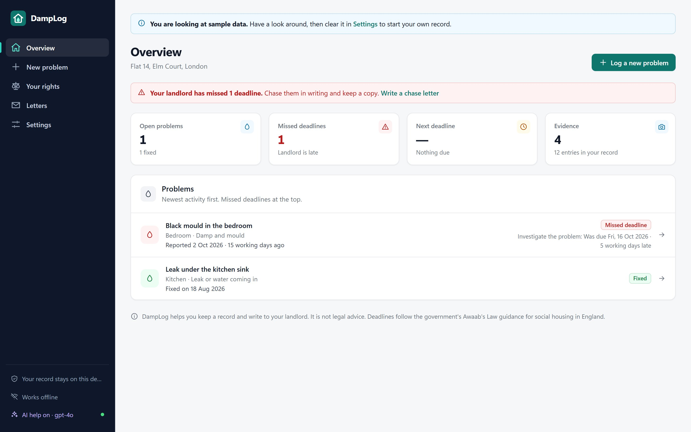
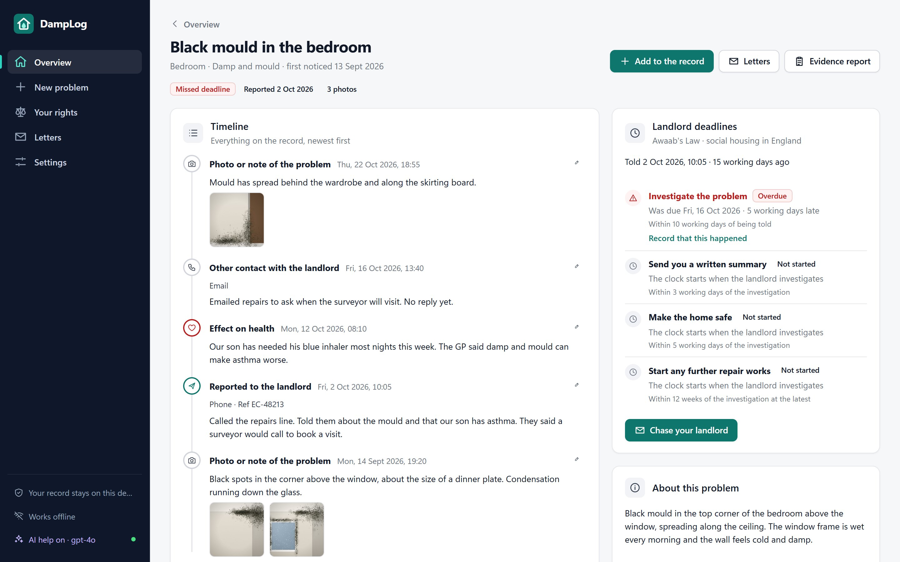
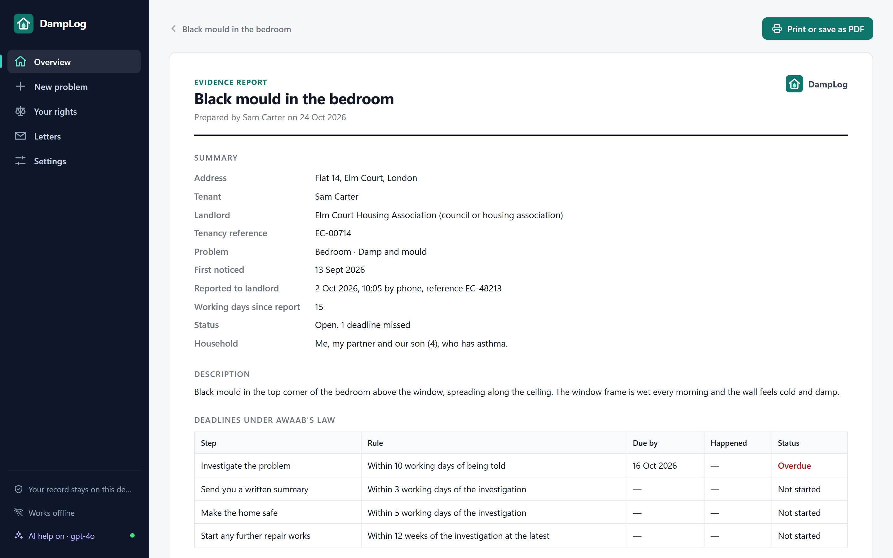
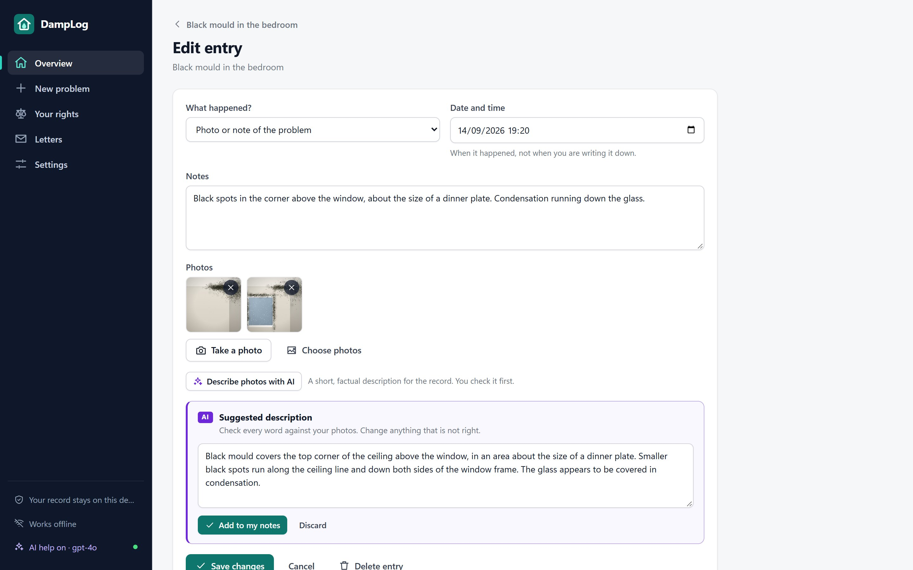
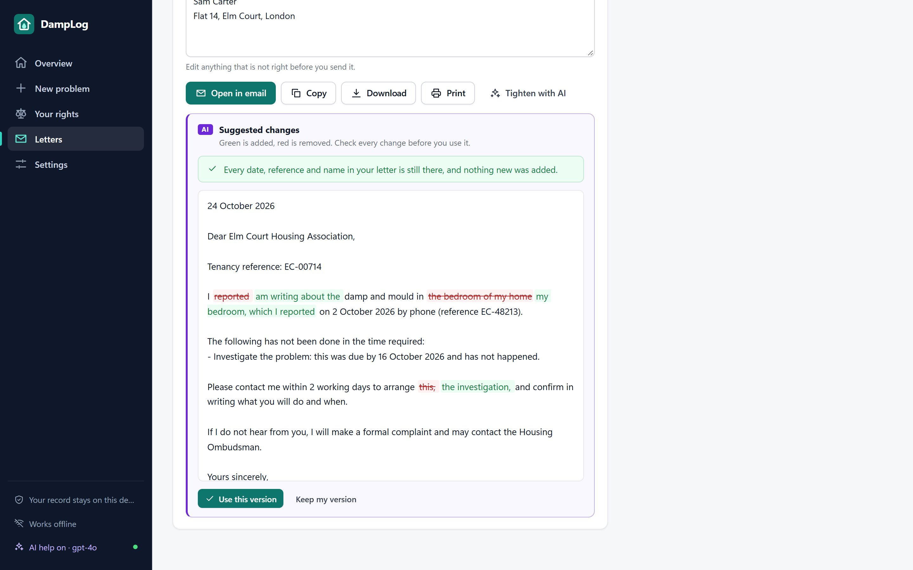
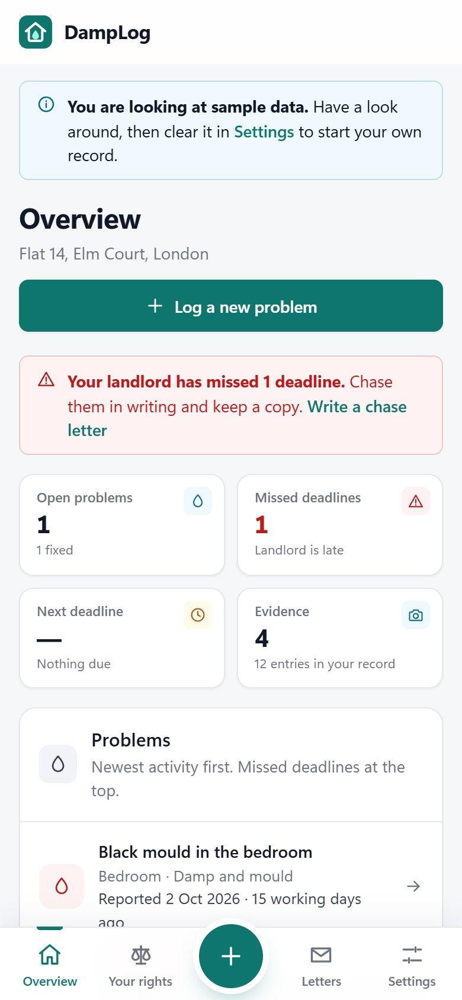
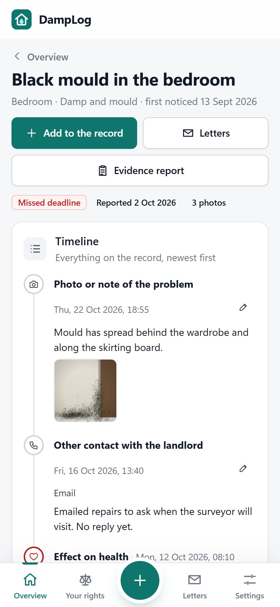

<div align="center">


# DampLog

**An evidence log for damp, mould and repairs in rented homes, with Awaab's Law deadline tracking.**

[**Live app**](https://talhaali-tech-engineer.github.io/DampLog/) &nbsp;·&nbsp; [Screenshots](#screenshots) &nbsp;·&nbsp; [How the deadlines are counted](#how-the-deadlines-are-counted) &nbsp;·&nbsp; [Run it locally](#run-it-locally)

[](https://github.com/talhaali-tech-engineer/DampLog/actions/workflows/test.yml)


</div>

DampLog helps tenants in England keep a dated record of damp, mould and disrepair, see the deadlines their landlord has to meet, and turn that record into letters and a printable evidence report. It runs in the browser, works offline and keeps everything on the tenant's own device.

> **Scope:** DampLog helps you keep a record and write to your landlord. It is not legal advice.

<div align="center">

</div>

## Problem

Since 27 October 2025, Awaab's Law has required councils and housing associations in England to investigate and fix damp and mould, and emergency hazards, within fixed deadlines. The law is named after Awaab Ishak, a two-year-old who died in 2020 after long exposure to mould in his family's housing association flat.

The deadlines only help a tenant who can show when the landlord was told and what happened next. In practice, that evidence is scattered across a phone's photo gallery, call history, emails and memory. When a deadline is missed, the tenant has to piece it together under pressure, and count working days by hand around weekends and bank holidays.

## What DampLog does

- **Dated evidence.** Photos, notes, calls, visits, missed appointments and effects on health, in one timeline per problem. Photos are shrunk and stored on the device.
- **Deadline tracker.** Once a problem is recorded as reported, DampLog works out each deadline under the regulations and shows whether the landlord is on time, late or overdue.
- **Letters.** One tap builds a letter to report the problem, chase a missed deadline or make a formal complaint, filled in from the record. You can edit it, copy it, email it or print it.
- **Evidence report.** A printable pack with the summary, deadlines, full timeline and numbered photos, ready for a complaint, the Housing Ombudsman or an adviser.
- **Optional AI help.** With the tenant's own OpenAI or Claude key, AI describes photos factually for the record and tightens letters. Nothing the AI writes is saved until the tenant accepts it. Letter changes are shown word by word, and code checks that no date, reference or name was dropped or invented and that no legal threat was added.
- **Your rights.** A plain-English summary of the deadlines and the route if a landlord does not act, with links to the official guidance.
- **Private renters.** For private landlords, the same steps are tracked without legal due dates, because Awaab's Law does not apply to private renting yet.

## Screenshots

| A problem's timeline and the landlord's deadlines | The printable evidence report |
| --- | --- |
|  |  |
| **AI describes the photos, you check the words** | **AI tightens a letter, every change shown and fact-checked** |
|  |  |

<div align="center">
&nbsp;&nbsp;

</div>

The screenshots use the built-in sample data. The sample photos are drawn by the app, not taken in a real home.

## How the deadlines are counted

DampLog follows the [Hazards in Social Housing (Prescribed Requirements) (England) Regulations 2025](https://www.legislation.gov.uk/uksi/2025/1042/contents/made) and the [government guidance for social landlords](https://www.gov.uk/government/publications/awaabs-law-guidance-for-social-landlords).

| Step | Deadline |
| --- | --- |
| Emergency hazard: investigate and make safe | 24 hours from when the landlord was told |
| Investigate significant damp and mould | 10 working days from when the landlord was told |
| Written summary to the tenant | 3 working days after the investigation |
| Make the home safe | 5 working days after the investigation |
| Start further repair works | 12 weeks after the investigation at the latest |

The day the landlord is told is day zero, and day one is the next working day. Working days exclude weekends, Christmas Day, Good Friday and bank holidays in England and Wales (taken from [GOV.UK](https://www.gov.uk/bank-holidays)). If the written summary says no significant hazard was found, the make-safe and works steps are marked as not needed.

## Privacy

There is no account, no server and no tracking. The record, including every photo, is stored in the browser's IndexedDB on the tenant's device. Letters only leave the device when the tenant sends them. AI help is off unless the tenant adds their own key; then only the photos of one entry, or the letter on screen, go to the provider, and only when an AI button is pressed. The key is never put in backups. A backup file, with photos included, can be downloaded and restored on another device.

## Technical architecture

- A static progressive web app: plain HTML, CSS and JavaScript modules, with no build step and no dependencies.
- `js/core.js` holds the rules: working days, deadlines, validation and backups. It has no DOM code and is unit-tested in Node.
- `js/letters.js` builds the letters from the record.
- `js/ai.js` sends requests straight from the browser to OpenAI or Anthropic, streams the reply, and checks rewritten letters against the original.
- `js/db.js` stores problems, entries and photos in IndexedDB, saving each change in one transaction.
- `js/photos.js` resizes photos on the device before saving them.
- `sw.js` caches the app so it opens without a connection.
- A strict Content Security Policy allows no third-party scripts, and network calls only to the two AI providers.

## Run it locally

```bash
npm start
```

Then open http://localhost:8080. Choose **Try it with sample data** to see a worked example. The sample photos are drawn by the app, not taken in a real home.

## Tests

```bash
npm test
```

The tests cover working days across Christmas and Easter, every deadline and status, the 24-hour emergency clock, private landlords, validation, backups, the letter wording, the AI requests for both providers, and the check that catches a rewritten letter dropping or inventing facts.

## Limitations

- The deadlines cover social housing in England only. Wales, Scotland and Northern Ireland have different rules.
- Photo dates come from the device. They are good evidence of a pattern, not proof on their own.
- The bank holiday list runs to the end of 2028 and needs updating after that.
- Letters are templates. Tenants should check them, and get advice for court action.

## Roadmap

- Track the further hazards the government is adding to Awaab's Law in 2026 and 2027.
- Export the evidence report straight to PDF.
- Translations, starting with the languages the government guidance is published in.

## Author

Created by Talha Ali ([@talhaali-tech-engineer](https://github.com/talhaali-tech-engineer)).

## Licence

[MIT](LICENSE)
